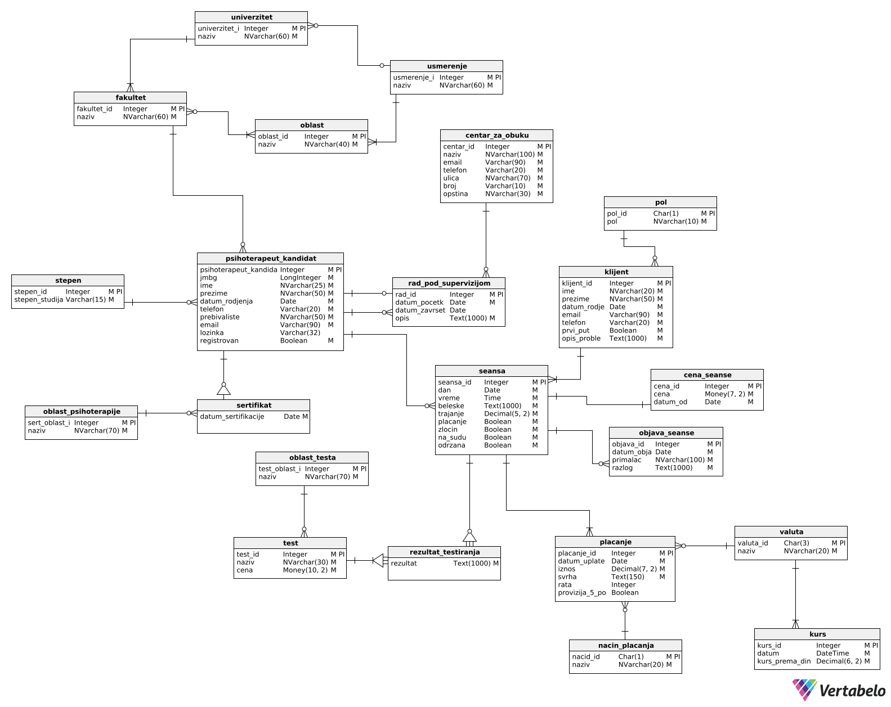
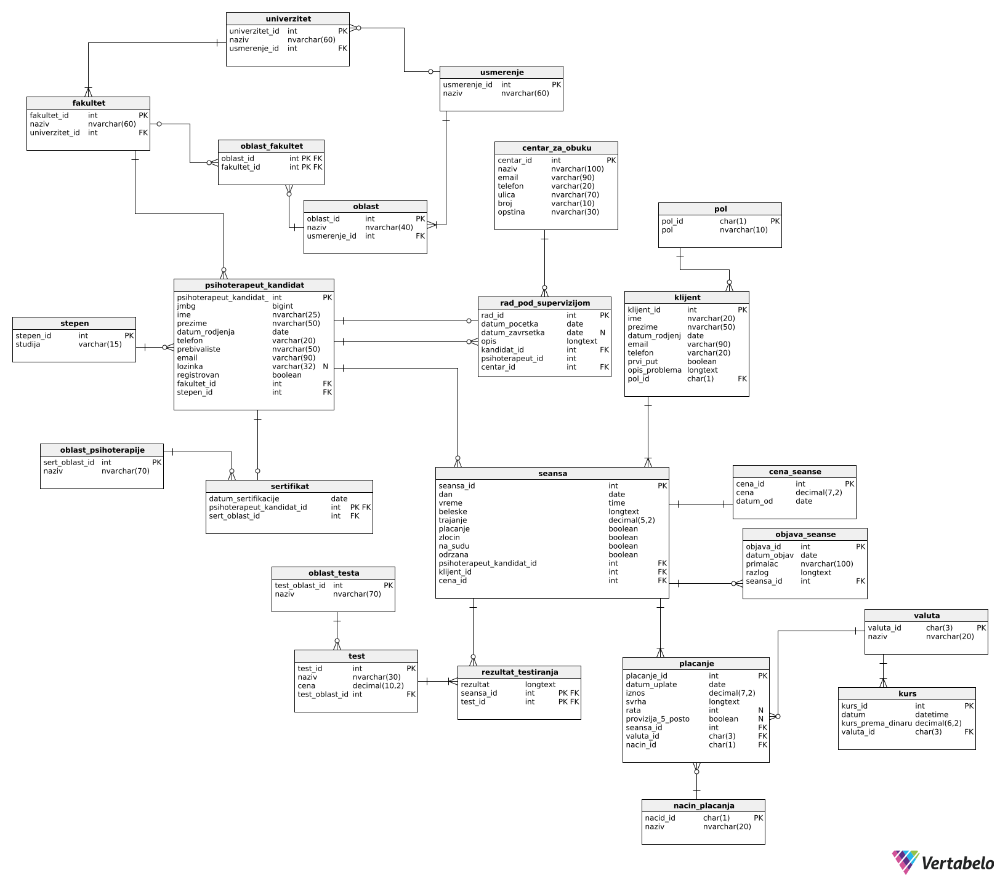

# Counseling Center "Novi početak" — Psychotherapy Practice Management System

A Java desktop application backed by a MySQL relational database, built as a team project for a university **Databases** course. The system models the work of a psychological counseling center: registration of psychotherapists, client intake questionnaires, session scheduling and execution, psychological testing, payments and debt tracking, disclosure of session data to third parties, and per-therapist reporting.

The application UI and the database schema use Serbian naming (e.g. `seansa` = session, `klijent` = client, `placanje` = payment).

---

## Table of Contents

- [Project Overview](#project-overview)
- [Features](#features)
- [Technologies Used](#technologies-used)
- [Application Architecture](#application-architecture)
- [Database Design](#database-design)
- [Entity Relationship / Database Models](#entity-relationship--database-models)
- [Database Structure](#database-structure)
- [Stored Procedures and SQL Logic](#stored-procedures-and-sql-logic)
- [How It Works](#how-it-works)
- [Project Structure](#project-structure)
- [Getting Started](#getting-started)
- [Database Setup](#database-setup)
- [Application Configuration](#application-configuration)
- [How to Run](#how-to-run)
- [Known Limitations](#known-limitations)
- [Team / Contributors](#team--contributors)

---

## Project Overview

The goal of the project was to design a normalized relational database for a counseling center and to build an application on top of it that exercises the schema through real use cases.

The domain covers:

- **Psychotherapists and candidates** — people with a university degree who either already hold a psychotherapy certificate or are still in training under supervision at a training center.
- **Clients** — people who apply for counseling by filling out a questionnaire and choosing a psychotherapist.
- **Sessions** — the first (free) session, scheduled future sessions, and held sessions with notes, duration and price.
- **Psychological tests** — tests performed during a session, with results and individual prices.
- **Payments** — full or installment payments for sessions, payments for tests, multiple currencies and payment methods.
- **Session disclosures** — records of when and why session data was disclosed to a third party (court, police, social services, etc.).

## Features

There are two kinds of application users: **psychotherapists** (who have accounts) and **clients** (who do not log in — they submit an intake questionnaire from the start screen).

### Start screen (no login required)

- List of all registered psychotherapists (name, contact, faculty, degree).
- **Client intake questionnaire** — a client selects a psychotherapist and submits personal data and a description of the problem; the client is stored in the database and then chooses a date and hour (09:00–20:00) for the **free first session**. The application rejects a time slot that is already taken for that therapist.
- **Psychotherapist registration** — starts with a JMBG (13-digit national ID) prompt. If the person is a candidate who has **completed supervised training**, the form is pre-filled from the database. Registration stores the account and a psychotherapy certificate (date and therapy area).
- **Psychotherapist login** — by e-mail and password; only registered users can log in.

### Psychotherapist dashboard (after login)

| Section | What it does |
|---|---|
| **Profile** | Personal data, faculty, degree, certificate date and therapy area. |
| **New clients** | Clients who have exactly one session with the logged-in therapist (i.e. newly applied). |
| **All clients** | All clients of the therapist; schedule a new session for a selected client (with a time-slot conflict check). |
| **Held sessions** | History of held sessions; double-click opens details (notes, tests and results, disclosures); view or create a **session disclosure** (recipient, reason, "crime" / "in court" flags). |
| **Upcoming sessions** | Scheduled future sessions; "hold" a session — enter duration and notes, add psychological tests with results, and optionally record payment. |
| **Payments** | Per-client list of payments (amount, currency, method, installment) and computed **debts** (unpaid sessions, overdue second installment, unpaid tests). |
| **Report** | Statistics: number of held sessions, first session date, average session start hour, client with the most sessions, income from sessions and tests (RSD), year with the highest income. |

## Technologies Used

| Technology | Role |
|---|---|
| **Java 22** | Application language (`maven.compiler.source/target = 22`). |
| **Java Swing** | Desktop GUI (`JFrame`, `JPanel`, `JTable`, `CardLayout`, dialogs). |
| **JDBC** | Database access via `Connection`, `PreparedStatement` and `CallableStatement`. |
| **MySQL Connector/J 9.2.0** | MySQL JDBC driver (`com.mysql:mysql-connector-j`). |
| **JCalendar 1.4** | Date picker component (`com.toedter:jcalendar`, `JDateChooser`). |
| **Maven** | Build and dependency management (`pom.xml`). |
| **MySQL** | Relational database server. |
| **SQL / stored procedures** | Schema definition, seed data and write-side business operations. |
| **Vertabelo** | Logical and physical data modeling; the DDL was generated from the model and then extended by hand. |

## Application Architecture

The application follows a simple layered architecture:

```
┌──────────────────────────────────────────────┐
│  view      Swing frames and panels (UI)      │
├──────────────────────────────────────────────┤
│  dao       Data Access Objects (SQL / CALL)  │
├──────────────────────────────────────────────┤
│  model     Plain Java objects / DTOs         │
├──────────────────────────────────────────────┤
│  utility   DatabaseConnection (JDBC)         │
└──────────────────────────────────────────────┘
                      │ JDBC
                      ▼
            MySQL database `savetovaliste`
       (tables + stored procedures + seed data)
```

- **`view`** — Swing windows. UI event handlers validate input, build model objects and call DAO methods.
- **`dao`** — one class per domain area (`PsihoKandDao`, `KlijentDao`, `SeansaDao`, `PlacanjeDao`, `IzvestajDao`, …). Read operations mostly use parameterized `SELECT` queries; most write operations call **stored procedures** via `{CALL ...}`.
- **`model`** — entities (`PsihoterapeutKandidat`, `Klijent`, `Seansa`, `Placanje`, `Test`, …) and view-oriented objects (`Dugovanje`, `TestRezultatDTO`, `Objava`).
- **`utility.DatabaseConnection`** — a static, singleton-style holder of a JDBC `Connection`, re-created when it is closed. Connection settings come from `db.properties` or environment variables, never from source code.

## Database Design

The schema was designed in **Vertabelo** — first as a logical (conceptual) model, then as a physical model for MySQL — and implemented with a SQL script that contains the DDL, foreign keys, seed data and stored procedures.

Key design points:

- **23 tables**, **24 foreign key constraints**, surrogate `AUTO_INCREMENT` keys for most entities and natural character keys for code tables (`valuta`, `stepen`, `pol`, `nacin_placanja`).
- **Single table for psychotherapists and candidates** (`psihoterapeut_kandidat`). A row becomes a *psychotherapist* when it has a row in `sertifikat` (one certificate per person — the certificate's primary key is the person's ID), and becomes an *application user* when `registrovan = TRUE`.
- **Self-referencing supervision**: `rad_pod_supervizijom` links a candidate with a supervising psychotherapist (both rows of `psihoterapeut_kandidat`) and a training center.
- **Session lifecycle** in one table: a scheduled session has `odrzana = FALSE`; when held, notes, duration, payment flag and price are filled in and `odrzana = TRUE`.
- **Price history**: `cena_seanse` stores prices with a validity start date (`datum_od`); the application uses the most recent one.
- **Associative tables**: `fakultet_oblast` (faculty ↔ area, M:N) and `rezultat_testiranja` (session ↔ test with a result, M:N).
- **Unique constraints** on natural identifiers such as JMBG, e-mail addresses and names of code-list entries; secondary indexes on `klijent(ime)`, `klijent(prezime)` and `seansa(dan)`.

## Entity Relationship / Database Models

### Logical model



*The logical model shows entities, attributes and relationships independently of the DBMS. `sertifikat` is modeled as a specialization of `psihoterapeut_kandidat` (a candidate who has a certificate is a psychotherapist), and `rezultat_testiranja` as a dependent entity between `seansa` and `test`.*

### Physical model



*The physical model maps the logical model to MySQL tables: concrete data types, primary keys (PK), foreign keys (FK), nullable columns (N), and the associative table between faculties and areas.*

> **Note:** The SQL script ([`database/savetovaliste.sql`](database/savetovaliste.sql)) is the authoritative definition. It differs from the physical model in a few places — for example, the associative table is named `fakultet_oblast`, `placanje.svrha` is an `ENUM`, and `placanje` has an extra `napomena` column.

## Database Structure

| Group | Table | Purpose |
|---|---|---|
| Education | `usmerenje` | Academic field (e.g. humanities, technical sciences). |
| | `univerzitet` | University, belongs to one field. |
| | `fakultet` | Faculty, belongs to one university. |
| | `oblast` | Study area, belongs to one field. |
| | `fakultet_oblast` | M:N link between faculties and areas. |
| | `stepen` | Degree level (`BSc`, `MSc`, `PhD`). |
| People | `psihoterapeut_kandidat` | Psychotherapists and candidates: JMBG, personal data, e-mail, password, faculty, degree, `registrovan` flag. |
| | `sertifikat` | Psychotherapy certificate (date, therapy area); PK = person ID. |
| | `oblast_psihoterapije` | Therapy area (CBT, Gestalt, family therapy, …). |
| | `centar_za_obuku` | Training center. |
| | `rad_pod_supervizijom` | Supervised training: candidate, supervisor, center, start/end dates. |
| | `klijent` | Client: personal data, first-time flag, problem description, gender. |
| | `pol` | Gender code list. |
| Sessions | `seansa` | Session: date, time, notes, duration, flags (`placanje`, `zlocin`, `na_sudu`, `odrzana`), client, therapist, price. |
| | `cena_seanse` | Session price history (`cena`, `datum_od`). |
| | `objava_seanse` | Disclosure of session data: date, recipient, reason. |
| Testing | `oblast_testa` | Test category. |
| | `test` | Psychological test with price and category. |
| | `rezultat_testiranja` | Result of a test performed in a session (PK = `test_id`, `seansa_id`). |
| Payments | `placanje` | Payment: date, amount, purpose (`SEANSA - CELA`, `SEANSA - PRVA RATA`, `SEANSA - DRUGA RATA`, `TEST`), installment, 5% fee flag, session, currency, method. |
| | `valuta` | Currency (`RSD`, `EUR`, `USD`, …). |
| | `kurs` | Exchange rate to RSD on a given date. |
| | `nacin_placanja` | Payment method (cash, card). |

Main relationships (all 1:N unless stated otherwise):

- `usmerenje` → `univerzitet` → `fakultet` → `psihoterapeut_kandidat` ← `stepen`
- `fakultet` ↔ `oblast` (M:N through `fakultet_oblast`)
- `psihoterapeut_kandidat` → `sertifikat` (1:0..1) ← `oblast_psihoterapije`
- `psihoterapeut_kandidat` / `centar_za_obuku` → `rad_pod_supervizijom`
- `klijent` → `seansa` ← `psihoterapeut_kandidat`; `cena_seanse` → `seansa`
- `seansa` → `placanje`, `objava_seanse`; `seansa` ↔ `test` (M:N through `rezultat_testiranja`)
- `valuta` → `placanje`, `kurs`; `nacin_placanja` → `placanje`

The script also inserts realistic **seed data** (e.g. 24 psychotherapists/candidates, 10 clients, 54 sessions, 57 payments, 40 exchange-rate records), intended for testing and demonstration.

## Stored Procedures and SQL Logic

The script defines **16 stored procedures** (no triggers, views or stored functions).

| Procedure | Purpose | Used by the app |
|---|---|---|
| `registruj_kandidata` | Inserts a new psychotherapist, or updates an existing candidate (matched by JMBG), and sets `registrovan = TRUE`. | Yes |
| `postavi_registrovan` | Sets `registrovan = TRUE` for a JMBG. | Yes |
| `dodaj_sertifikat` | Inserts a certificate for a person and therapy area. | Yes |
| `obrisi_kandidata_po_emailu` | Deletes a person by e-mail. | DAO only (UI button disabled) |
| `get_sertifikovani_psihoterapeuti` | Lists certified psychotherapists with certificate data. | No |
| `get_kandidati_na_superviziji` | Lists candidates currently in supervision. | No |
| `proveri_kandidata_sa_zavrsenim_radom` | Returns a candidate (by JMBG) who has finished supervision. | No (equivalent inline query is used) |
| `dodaj_klijenta` | Inserts a client inside a transaction with rollback on error. | Yes |
| `dodaj_seansu` | Inserts a full session row (used for the free first session). | Yes |
| `zakazi_seansu` | Inserts a scheduled session (`odrzana = FALSE`). | Yes |
| `oznaci_seansu_kao_odrzanu` | Fills in notes, duration, payment flag, price and sets `odrzana = TRUE`. | Yes |
| `dodaj_rezultat_za_test` | Inserts a test result for a session. | Yes |
| `vrati_testove_za_seansu` | Returns tests, prices and results for a session. | Yes |
| `objavi_seansu` | Inserts a disclosure and updates the session's `zlocin` / `na_sudu` flags. | Yes |
| `unesi_placanja_za_celu_seansu` | Inserts a full-session payment using the session's price. | Yes |
| `unesi_placanje_testa` | Inserts a test payment. | Yes |

Other notable SQL logic lives in the DAO layer:

- **Debt detection** (`PlacanjeDao`) — correlated `EXISTS` / `NOT EXISTS` subqueries detect held sessions with no payment, a first installment without a second one after 30 days (`DATEDIFF`), and tests without a matching `TEST` payment.
- **Reporting** (`IzvestajDao`) — aggregate queries with `COUNT`, `SUM`, `MIN`, `AVG(TIME_TO_SEC(...))`, `GROUP BY`, `YEAR()` and `ORDER BY ... LIMIT 1`.
- **Current price** (`CenaDao`) — a subquery picking the row with `MAX(datum_od)`.

## How It Works

**Client intake and first session**

1. The client selects a therapist on the start screen and fills out the questionnaire (`UpitnikFrame`).
2. The app checks that the e-mail is not already used and calls `dodaj_klijenta`.
3. In `PrvaSeansaFrame` the client picks a date and an hour; the app checks `seansa` for a session of the same therapist at the same date and time, then calls `dodaj_seansu` with a free, already-held first session (no price, not paid).

**Scheduling and holding a session**

1. In *All clients*, the therapist schedules a session (`ZakaziSeansuFrame`); after the same conflict check, `zakazi_seansu` inserts it with `odrzana = FALSE`.
2. The session appears under *Upcoming sessions* (`odrzana = FALSE AND dan >= CURDATE()`).
3. When holding it (`OdrziSeansuFrame`), the app reads the current price, calls `oznaci_seansu_kao_odrzanu`, inserts each test result with `dodaj_rezultat_za_test`, and — if the session was paid on the spot — records the session and test payments.

**Registration and login**

1. Registration validates the form, checks whether the JMBG or e-mail is already registered, and calls `registruj_kandidata`, `postavi_registrovan` and `dodaj_sertifikat`.
2. Login runs a parameterized query matching e-mail, password and `registrovan = TRUE`, joined with faculty, degree and certificate data for the profile.

## Project Structure

```
projekat_baze_podataka/
├── pom.xml
├── db.properties.example                  # template for local DB credentials (copy to db.properties)
├── database/
│   └── savetovaliste.sql                  # complete database script (schema, FKs, seed data, procedures)
├── docs/
│   └── images/
│       ├── logical-model.png
│       └── physical-model.png
└── src/main/
    ├── java/savetovaliste/
    │   ├── Main.java                      # entry point: tests the DB connection, opens the start window
    │   ├── utility/DatabaseConnection.java  # reads DB settings from db.properties / environment variables
    │   ├── dao/                           # CenaDao, FakultetDao, IzvestajDao, KlijentDao, OblastPsihoterapijeDao,
    │   │                                  # PlacanjeDao, PolDao, PsihoKandDao, SeansaDao, StepenDao, TestDao, UniverzitetDao
    │   ├── model/                         # Dugovanje, Fakultet, Klijent, Objava, OblastPsihoterapije, Placanje, Pol,
    │   │                                  # PsihoterapeutKandidat, Seansa, Test, TestRezultatDTO, Univerzitet
    │   └── view/
    │       ├── PregledPsihoterapeutaFrame.java   # start window
    │       ├── PrijavaFrame.java                 # login
    │       ├── RegistracijaFrame.java            # registration
    │       ├── klijent/                          # UpitnikFrame, PrvaSeansaFrame
    │       └── psihoterapeut/
    │           ├── frameovi/                     # profile window and dialogs (schedule, hold, publish, payments, debts, …)
    │           └── paneli/                       # dashboard sections (profile, clients, sessions, payments, report)
    └── resources/                         # icons and images used by the UI
```

## Getting Started

### Prerequisites

- **JDK 22** or newer
- **Maven** (or an IDE with Maven support, e.g. IntelliJ IDEA)
- **MySQL Server** running locally (the application connects to port `3306` by default)
- A MySQL client to run the SQL script (MySQL Workbench or the `mysql` command-line client)

## Database Setup

The whole database is created by **one SQL script**: [`database/savetovaliste.sql`](database/savetovaliste.sql). Every developer runs it once on their **own local MySQL server** — the database is not shared; it lives on whichever server the script is executed against.

The script runs, in order:

1. `CREATE DATABASE IF NOT EXISTS savetovaliste;` and `USE savetovaliste;`
2. `CREATE TABLE` statements for all 23 tables (primary keys, unique constraints, indexes)
3. `ALTER TABLE ... ADD CONSTRAINT ... FOREIGN KEY` for all relationships
4. `INSERT` statements with seed data, ordered so that referenced rows exist first
5. `DROP PROCEDURE IF EXISTS` and `CREATE PROCEDURE` for all stored procedures (using `DELIMITER`)

**Option A — MySQL Workbench**

1. Connect to your local server (e.g. *Local instance MySQL*).
2. *File → Open SQL Script…* and select `database/savetovaliste.sql`.
3. Execute the whole script (the lightning-bolt icon, **not** "execute current statement").
4. Refresh the *Schemas* panel — the `savetovaliste` schema should appear.

**Option B — command line**

```bash
mysql -u <your_user> -p < database/savetovaliste.sql
```

Run it as a MySQL user that is allowed to create databases.

> The `CREATE TABLE` statements do not use `IF NOT EXISTS`, so the script is meant to be run against a server where `savetovaliste` does not exist yet. To re-create it, run `DROP DATABASE savetovaliste;` first (this deletes all its data).

Compared with the originally submitted course script, this version contains two fixes: the foreign key on `rad_pod_supervizijom.kandidat_id` (previously both supervision FKs pointed to `psihoterapeut_id`) and a `DELIMITER ;` statement that was missing a space.

The application does **not** create the schema itself — it expects the `savetovaliste` database, its tables and stored procedures to already exist.

## Application Configuration

No credentials are stored in the source code. `DatabaseConnection` reads the connection settings at start-up from a local, untracked file **`db.properties`** in the project root.

1. Copy the template:

   ```bash
   cp db.properties.example db.properties        # Windows: copy db.properties.example db.properties
   ```

2. Fill in your own MySQL credentials:

   ```properties
   db.url=jdbc:mysql://localhost:3306/savetovaliste
   db.user=<your MySQL user>
   db.password=<your MySQL password>
   ```

| Key | Meaning |
|---|---|
| `db.url` | JDBC URL — host, port and database name (default `jdbc:mysql://localhost:3306/savetovaliste`) |
| `db.user` | MySQL user name |
| `db.password` | MySQL password |

`db.properties` is listed in `.gitignore`, so your credentials stay on your machine. Never commit it.

**Alternative — environment variables.** `DB_URL`, `DB_USER` and `DB_PASSWORD` take precedence over the file when they are set (e.g. in an IntelliJ run configuration under *Environment variables*).

If neither is configured, the application stops with a message explaining which file to create.

## How to Run

**IntelliJ IDEA (recommended)**

1. Open the project folder; IntelliJ imports it as a Maven project and downloads the dependencies.
2. Make sure the project SDK is JDK 22+.
3. Create the database with `database/savetovaliste.sql` and create your `db.properties` (see above).
4. Run `savetovaliste.Main`.

The working directory must be the **project root**, because `db.properties` and the UI images (e.g. `src/main/resources/logo.png`) are loaded with paths relative to it. This is IntelliJ's default for application run configurations.

On start-up, `Main` opens a database connection (it prints a confirmation on success; a failed connection throws a `RuntimeException`) and then shows the start window with the list of psychotherapists.

**Trying it out with the seed data:** pick any psychotherapist on the start screen and submit a questionnaire to create a client, or log in with the e-mail and password of one of the registered psychotherapists from the seed data in the SQL script.

## Known Limitations

This is an educational project; the following points are known and intentionally out of scope:

- User passwords are stored and compared in plain text (no hashing).
- Clients do not have accounts; there is no administrator role.
- The "hold session" workflow runs several independent statements (session update, test results, payments) rather than one database transaction.
- Session conflicts are prevented only by an application-level check for an identical date and time; there is no unique constraint and no check for overlapping durations.
- Exchange rates (`kurs`) and installment payments exist in the data model and seed data but are not managed through the UI; reports only sum RSD payments.

## Team / Contributors

This project was developed jointly as a team project by:

- **Katarina Gordić** (RN 41/2023)
- **Anja Stanković** (RN 58/2023)
